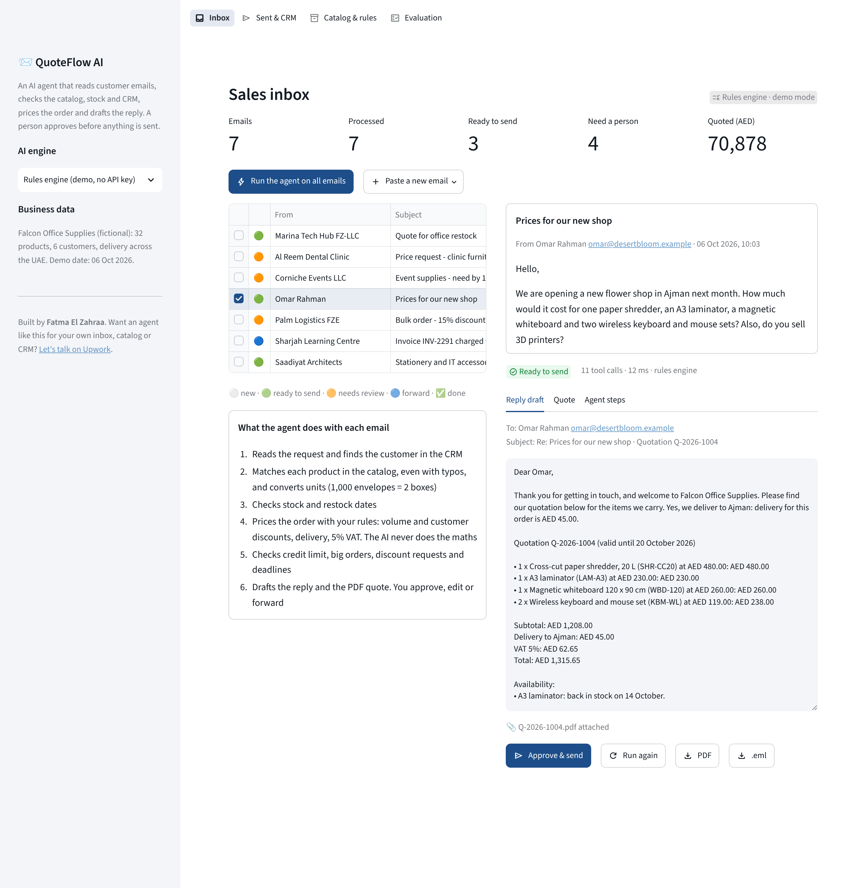
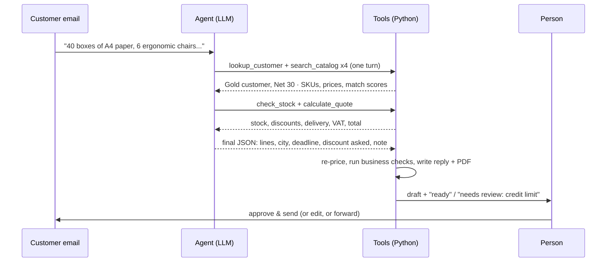
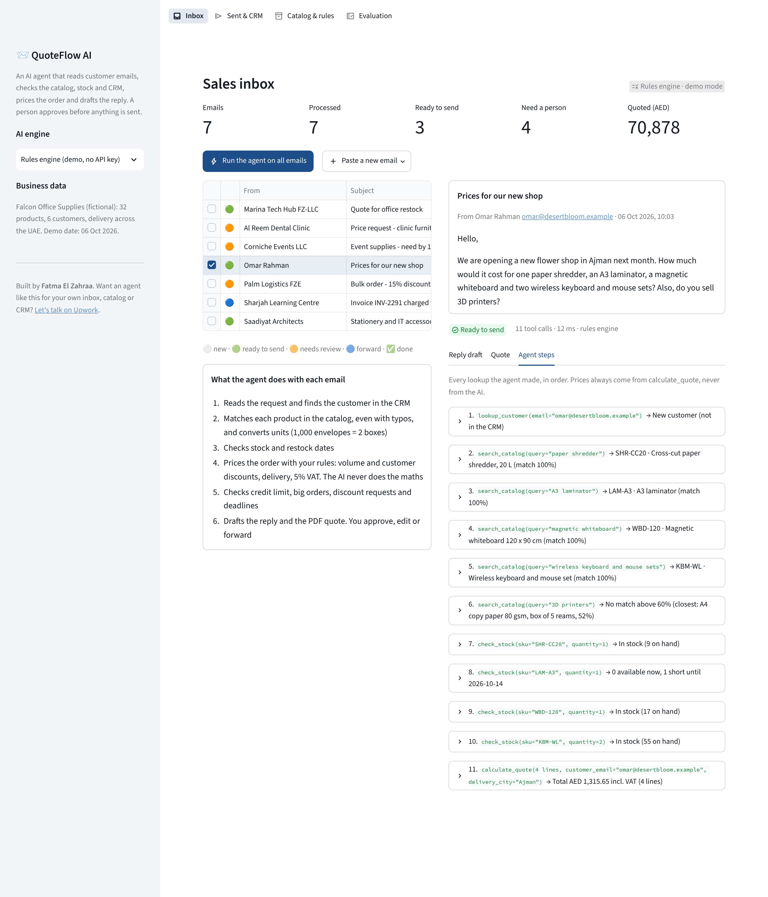
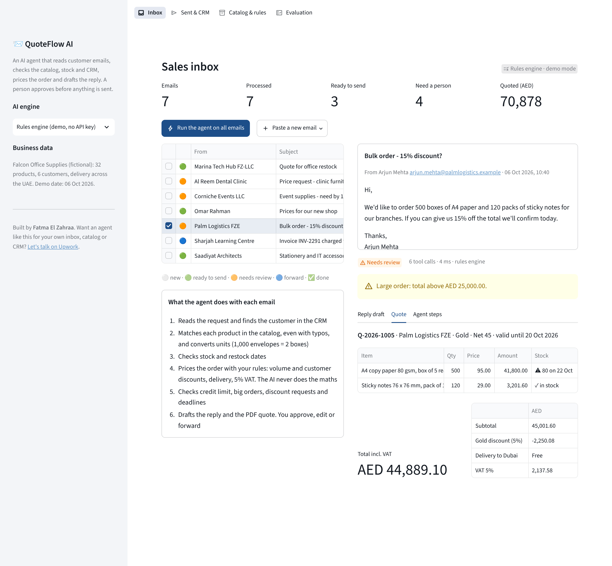
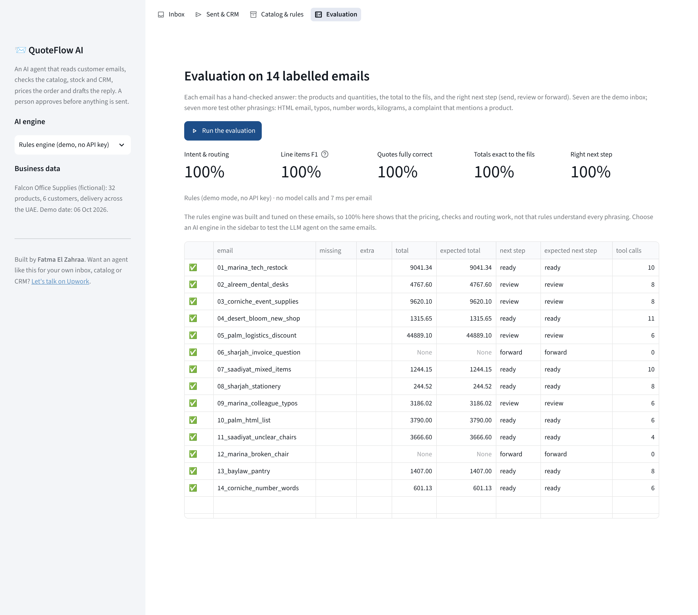

# QuoteFlow AI: an Email-to-Quote Agent for B2B Sales


Sales teams lose hours turning emails like *"pls send your best price for 1,000 DL envelopes, half a dozen
staplers, 10 nos HDMI cables"* into quotations. QuoteFlow is an AI agent that does the groundwork:

1. reads the email and finds the customer in the CRM;
2. matches every product in the catalog, even with typos, and converts units;
3. checks stock and restock dates;
4. prices the order with the company's own rules;
5. drafts the reply with a PDF quotation.

A person approves with one click. Anything risky is flagged for review first: credit limit, a large order, a
discount request, or a deadline the stock can't meet.

It runs on the **free Google Gemini tier** (also OpenAI, Groq or a local Ollama model) through standard
**function calling**. A rules engine handles the same inbox with no API key, for demos and as a fallback.



## What it does

| | |
|---|---|
| 🤖 **Tool-calling agent** | The model decides which tools to call: `lookup_customer`, `search_catalog`, `check_stock`, `calculate_quote`. It can call several at once, so a quote usually takes about 3 model calls (fits free tiers) |
| 🧮 **No AI arithmetic** | Prices, volume and customer discounts, delivery and 5% VAT come from tested Python with exact decimal rounding. The model only writes the friendly note at the top of the reply |
| 🔎 **Reads real emails** | Typos, "half a dozen", "2 x", "10 nos", HTML emails, "1,000 envelopes" → 2 boxes of 500, "6 kg of coffee beans" → 6 bags, products we don't sell, unclear requests ("some chairs" → asks which ones) |
| ✅ **Human in the loop** | Every email gets a next step: ready to send, needs review (with the reasons), or forward to accounts / customer service. Replies can be edited before sending |
| 📄 **Real outputs** | PDF quotation, a reply `.eml` that opens in Outlook or Gmail (threaded, PDF attached) and a CRM log |
| 🧾 **Full trace** | Every tool call with its arguments and result, so a manager can see exactly what the agent looked up |
| 🛡️ **Guardrails** | SKUs the model invents are dropped and flagged. Bad tool calls return errors the model can correct. If the model fails, the rules engine prepares the draft instead |
| 🧪 **Measured** | 14 hand-labelled emails, scored on products, quantities, totals to the fils and the right next step, plus 67 automated tests |

## How the agent works



## The sample inbox

Seven emails to *Falcon Office Supplies*, a fictional office-supplies distributor in the UAE:

| Email | What the agent does |
|---|---|
| Marina Tech Hub: paper, markers, chairs, pens | Gold discount, free delivery, AED 9,041.34: **ready to send** |
| Al Reem Dental: standing desks and chairs | Open balance + this quote exceed the credit limit: **review** |
| Corniche Events: 300 cases of water by 15 October | Only 180 in stock until 20 October: offers a split delivery and **flags the deadline** |
| Desert Bloom (new customer): shredder, laminator… "and 3D printers?" | New-customer terms, Ajman delivery fee, laminator back on 14 October, says we don't sell 3D printers |
| Palm Logistics: "15% off and we confirm today" | Shows that volume + Gold discounts already give 16.1% off; large order: **review** |
| Sharjah Learning Centre: invoice charged twice | Not a quote: **forward to accounts** |
| Saadiyat Architects: "1,000 DL envelopes, half a dozen staplers…" | 2 boxes of 500 envelopes, 6 staplers, 10 cables, 2 toners |

| Agent steps (trace) | Quote and review reasons |
|---|---|
|  |  |

## Evaluation

`python -m quoteflow eval` runs the agent on 14 labelled emails: the 7 above, plus 7 that test other
phrasings (HTML email, typos, number words, kilograms, a colleague of a known customer, a complaint that
mentions a product).

| Engine | Intent & routing | Line items F1 | Quotes fully correct | Totals exact | Right next step |
|---|---|---|---|---|---|
| Rules engine (offline) | 100% | 100% | 100% | 100% | 100% |

The rules engine was built and tuned on these emails, so this score shows that the pricing, checks and routing
work end to end. It does not mean the rules understand every way people write. The LLM agent is what handles
open-ended emails: run the same test with `python -m quoteflow --provider gemini eval` (about 40 model calls).



## Quick start

**Windows:** double-click `run_windows.bat` · **macOS / Linux:** `./run_mac_linux.sh`

**Manual:**

```bash
python -m venv .venv
.venv\Scripts\activate          # Windows   (macOS/Linux: source .venv/bin/activate)
pip install -r requirements.txt
streamlit run app.py
```

Click **Run the agent on all emails**, open any email, and approve or edit the draft. For the LLM agent, pick
**Google Gemini (free tier)** in the sidebar and paste a free key from
[aistudio.google.com/apikey](https://aistudio.google.com/apikey). You can also paste your own test email into
the inbox.

### Command line

```bash
python -m quoteflow run inbox/04_desert_bloom_new_shop.eml          # prints the draft reply
python -m quoteflow inbox --save outbox                             # all emails: .eml + PDF + crm_log.csv
python -m quoteflow eval --out results.csv
python -m quoteflow --provider gemini run inbox/05_palm_logistics_discount.eml   # key in GEMINI_API_KEY
```

### Use it with your own business

* Replace the four files in [`data/`](data/README.md) with exports from your systems: catalog, stock,
  customers and pricing rules. The `aliases` column (the words customers really use) does most of the matching
  work.
* Put real emails (`.eml`, saved from Outlook or Gmail) in `inbox/`, or paste them into the app.
* Deploy for free on [Streamlit Community Cloud](https://share.streamlit.io) with `GEMINI_API_KEY` in the
  app's secrets ([example](.streamlit/secrets.toml.example)). Use a free-tier key so there is never a bill.

## Under the hood

```
quoteflow/
├── tools.py     # the 4 tools + JSON schemas for function calling, trace of every call
├── agent.py     # LLM tool loop (max steps, retries, JSON validation, fallback) and rules agent
├── pricing.py   # Decimal maths: volume / tier discounts, delivery zones, VAT, credit and deadline checks
├── catalog.py   # product matching: IDF-weighted word F1 + typo tolerance, ambiguity detection
├── extract.py   # rule-based reading of quantities, units, discounts, deadlines and intent
├── compose.py   # reply text, PDF quotation (ReportLab), .eml with attachment
├── crm.py       # CRM log, quote numbering, outbox
├── evaluate.py  # scores on labelled emails
├── llm.py       # one client for Gemini / OpenAI / Groq / Ollama, function calling included
└── data.py      # loads the CSV / JSON business data
app.py           # Streamlit app: Inbox, Sent & CRM, Catalog & rules, Evaluation
```

* **Function calling across providers.** Tool calls follow the OpenAI format, which Gemini, Groq and Ollama
  also accept. Provider-specific fields (such as Gemini's thought signatures) are passed back unchanged.
  Missing tool-call IDs are generated so every result reaches the right call.
* **The model's answer is checked.** The final JSON is validated against the real catalog, and the order is
  priced again by `pricing.py` before anything is shown. A model can't change a price or invent a product.
* **Business checks** run on every quote: credit exposure, order value, the discount asked vs the discounts
  already given, stock vs the customer's deadline, unknown delivery city, and a sender matched only by company
  email domain.

## Tests

```bash
pip install -r requirements-dev.txt
pytest
```

67 tests cover the pricing maths (checked by hand), product matching, quantity reading, the LLM tool loop with
scripted models and over HTTP against a fake OpenAI-compatible API, the PDF and `.eml` outputs, the command
line and the Streamlit app.

## Limitations

* The rules engine covers common ways of writing an order. Open-ended or unusual emails need the LLM agent.
* The app writes `.eml` files instead of sending email. Connecting a real mailbox (Gmail API, Microsoft Graph
  or IMAP/SMTP) is the step from demo to production.
* Stock and CRM data are CSV files here. In production they would be API calls to the ERP / CRM, and only the
  tool functions would change.

---

Built by **Fatma El Zahraa**, Data Scientist & ML Engineer.
Want an agent like this for your own inbox, catalog or CRM?
[Contact me on Upwork](https://www.upwork.com/freelancers/~01f79195ceec502c59).
